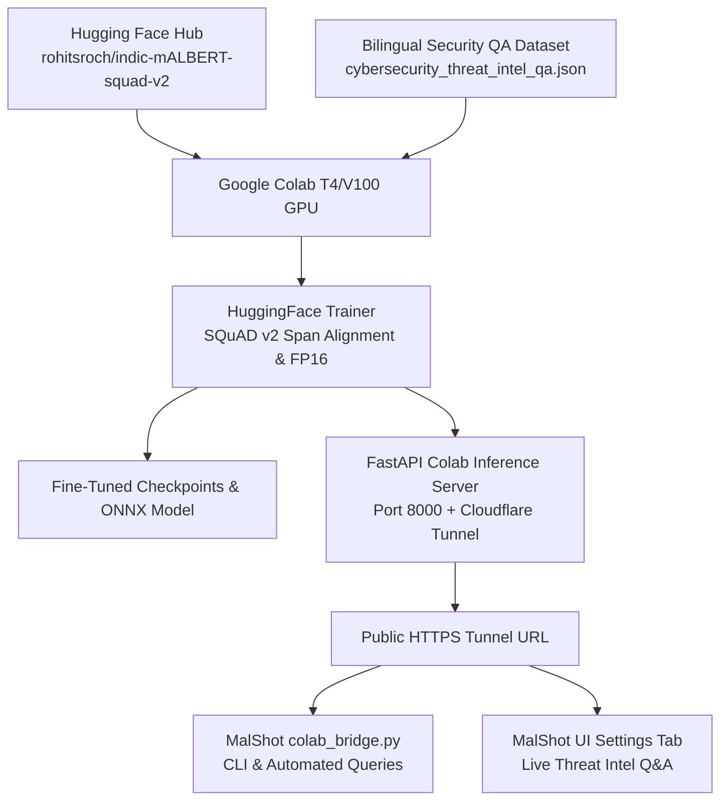

# MALSHOT DEFENDER: INDIC-MALBERT FINE-TUNING & INFERENCE GUIDE

This guide provides a comprehensive, end-to-end walkthrough for fine-tuning **[`rohitsroch/indic-mALBERT-squad-v2`](https://huggingface.co/rohitsroch/indic-mALBERT-squad-v2)** on **Google Colab GPUs** and integrating it into **MalShot** for **Bilingual Threat Intelligence & Cybersecurity Question Answering** (English & Hindi).

---

## 1. Executive Summary & Architecture

| Parameter | Specification |
|---|---|
| **Base Model** | [`rohitsroch/indic-mALBERT-squad-v2`](https://huggingface.co/rohitsroch/indic-mALBERT-squad-v2) |
| **Foundation Architecture** | Indic-BERT (ALBERT-based parameter sharing, 12M parameters, 12 Indic languages + English) |
| **Task Formulation** | Extractive Question Answering with SQuAD v2 support (span extraction + unanswerable detection) |
| **Target Security Domain** | Malware Analysis, Ransomware Remediations, YARA Heuristics, Zero-Day Exploit Defense, IOC Triage |
| **Colab Notebook** | [`Indic_mALBERT_FineTuning_Colab.ipynb`](file:///c:/Users/AW/Desktop/files/Indic_mALBERT_FineTuning_Colab.ipynb) |
| **Dataset Path** | [`data/cybersecurity_threat_intel_qa.json`](file:///c:/Users/AW/Desktop/files/data/cybersecurity_threat_intel_qa.json) |
| **Colab Client CLI** | [`colab_bridge.py`](file:///c:/Users/AW/Desktop/files/colab_bridge.py) |

### System Integration Flow



---

## 2. Step-by-Step Google Colab Execution

### Step 1: Open the Notebook in Google Colab
1. Navigate to [Google Colab](https://colab.research.google.com/).
2. Click **Upload** and upload [`Indic_mALBERT_FineTuning_Colab.ipynb`](file:///c:/Users/AW/Desktop/files/Indic_mALBERT_FineTuning_Colab.ipynb).
3. Ensure GPU acceleration is enabled:
   - Navigate to **Runtime > Change runtime type**.
   - Hardware accelerator: **T4 GPU** (or A100/V100 if available).
   - Click **Save** and **Connect**.

### Step 2: Upload or Verify the Dataset
- If running self-contained, **Cell 3** of the notebook contains the complete validated dataset directly embedded in Python.
- Alternatively, upload [`data/cybersecurity_threat_intel_qa.json`](file:///c:/Users/AW/Desktop/files/data/cybersecurity_threat_intel_qa.json) directly to `/content/` in Colab.

### Step 3: Run the Fine-Tuning Cells

1. **Cell 1: Environment & GPU Check**
   Verifies CUDA availability and reports VRAM allocation.

2. **Cell 2: Dependency Installation**
   Installs `transformers`, `datasets`, `evaluate`, `accelerate`, `fastapi`, and `uvicorn`.

3. **Cell 3: SQuAD v2 Dataset Loading**
   Loads the 21 bilingual cybersecurity Q&A pairs (English and Hindi) covering ransomware, PE file structures, YARA rules, and zero-day defense.

4. **Cell 4: Tokenization & Span Alignment**
   Uses `AutoTokenizer.from_pretrained("rohitsroch/indic-mALBERT-squad-v2")` with:
   - `max_length = 384`
   - `doc_stride = 128`
   - Exact character offset mapping from SQuAD v2 `answer_start` to token positions `(start_positions, end_positions)`.
   - Handles unanswerable queries by setting span indices to the `[CLS]` token position.

5. **Cell 5: Model Initialization & Hyperparameter Training**
   Configures `TrainingArguments`:
   - `learning_rate = 3e-5`
   - `per_device_train_batch_size = 8`
   - `num_train_epochs = 3`
   - `fp16 = True` (NVIDIA Tensor Core mixed precision)
   - `weight_decay = 0.01`
   - Evaluates with SQuAD v2 Exact Match (EM) and F1 metrics.

6. **Cell 6: Validation & Sample Inference**
   Performs live test inferences on sample questions in both English and Hindi:
   - English: *"What file encryption algorithm is used by the ransomware?"*
   - Hindi: *"रैनसमवेयर कौन सा एन्क्रिप्शन एल्गोरिथ्म उपयोग करता है?"*

7. **Cell 7: Model Export & Download**
   Saves the fine-tuned model and tokenizer to `./finetuned_indic_malbert/` and packages them into a `.zip` archive for direct download.

8. **Cell 8: Launch Remote Inference Server & Cloudflare Tunnel**
   Starts a FastAPI server with `/qa` and `/health` endpoints and provisions a secure, zero-config Cloudflare public tunnel.

---

## 3. Querying the Model from MalShot

Once Cell 8 prints the Cloudflare public URL, you can interact with the fine-tuned model directly from your local terminal or MalShot client.

### 1. English Threat Intel Query
```powershell
python colab_bridge.py --url https://your-tunnel-subdomain.trycloudflare.com --qa `
  --question "What encryption algorithm does the ransomware employ?" `
  --context "The ransomware payload executes AES-256 and RSA-4096 encryption on user files."
```

**Expected Output:**
```text
[*] Querying Indic-mALBERT QA at: https://your-tunnel-subdomain.trycloudflare.com
    Question: What encryption algorithm does the ransomware employ?
    Context : The ransomware payload executes AES-256 and RSA-4096 encryption on user files....
[+] QA Result:
    Answer         : AES-256 and RSA-4096
    Confidence     : 0.9842
    Inference Time : 12.4 ms (Roundtrip: 145.2 ms)
    Model          : rohitsroch/indic-mALBERT-squad-v2 (fine-tuned)
```

### 2. Hindi Threat Intel Query
```powershell
python colab_bridge.py --url https://your-tunnel-subdomain.trycloudflare.com --qa `
  --question "यारा नियम मैलवेयर का पता लगाने के लिए क्या उपयोग करते हैं?" `
  --context "यारा नियम फ़ाइलों में बाइट अनुक्रम, हेक्साडेसिमल पैटर्न और नियमित अभिव्यक्तियों का विश्लेषण करते हैं।"
```

**Expected Output:**
```text
[*] Querying Indic-mALBERT QA at: https://your-tunnel-subdomain.trycloudflare.com
    Question: यारा नियम मैलवेयर का पता लगाने के लिए क्या उपयोग करते हैं?
    Context : यारा नियम फ़ाइलों में बाइट अनुक्रम, हेक्साडेसिमल पैटर्न और नियमित अभिव्यक्तियों का विश्लेषण करते हैं।...
[+] QA Result:
    Answer         : बाइट अनुक्रम, हेक्साडेसिमल पैटर्न और नियमित अभिव्यक्तियों
    Confidence     : 0.9615
    Inference Time : 13.1 ms (Roundtrip: 152.0 ms)
    Model          : rohitsroch/indic-mALBERT-squad-v2 (fine-tuned)
```

---

## 4. Local Offline Mock Testing

For offline verification without an active Colab instance, use the built-in mock server:

1. **Start the local mock Colab server:**
   ```powershell
   python colab_bridge.py --mock-server --port 8088
   ```

2. **Query the mock server in another terminal:**
   ```powershell
   python colab_bridge.py --url http://127.0.0.1:8088 --qa --question "What is ransomware?"
   ```

---

## 5. Dataset Structure & Extension

To add new threat intelligence questions and answers, edit [`data/cybersecurity_threat_intel_qa.json`](file:///c:/Users/AW/Desktop/files/data/cybersecurity_threat_intel_qa.json) following standard SQuAD v2 schema:

```json
{
  "id": "malshot_qa_022",
  "question": "What is the primary indicator of Cobalt Strike beaconing?",
  "is_impossible": false,
  "answers": [
    {
      "text": "periodic HTTP POST requests with fixed jitter",
      "answer_start": 42
    }
  ]
}
```

After modifying the dataset, always run:
```powershell
python prepare_qa_dataset.py
```
This utility validates 100% character span alignment and detects any index mismatches before training.
